# Python examples

Install the native package using [BUILDING.md](../../BUILDING.md#python-bindings). Each example compiles its own shaders, so `glslc` must be discoverable. Run each from the directory containing its script, JSON, and `shaders/`.

| Directory | Run | Demonstrates |
|---|---|---|
| [getting_started/demo](../../examples/python/getting_started/demo) | `python demo.py` | PBR/IBL scene and facade use |
| [getting_started/ecs_bindings_demo](../../examples/python/getting_started/ecs_bindings_demo) | `python ecs_bindings_demo.py` | Custom Python components and systems |
| [getting_started/ui_canvas_demo](../../examples/python/getting_started/ui_canvas_demo) | `python ui_canvas_demo.py` | Canvas UI on the default pipeline: a HUD with a toggle, slider and button, and a clickable screen in the world |
| [animation/skinned_fox_demo](../../examples/python/animation/skinned_fox_demo) | `python skinned_fox_demo.py` | Skeletal animation |
| [rendering/japanese_shrine](../../examples/python/rendering/japanese_shrine) | `python shrine.py`, `python shrine_default.py` | Deferred PBR of a downloaded glTF model with IBL, sun shadows, sky and fog; the second on the default pipeline |
| [rendering/alley](../../examples/python/rendering/alley) | `python alley.py` | A tech demo on the default pipeline, built from Poly Haven models: dusk to night, ray-traced and local-light shadows, lit windows, a walking fox |
| [rendering/showroom](../../examples/python/rendering/showroom) | `python showroom.py` | Cars and starships on a turntable: a virtual shadow map, ray-traced soft light shadows and reflections, studio, hard-light, night and neon lighting, stills and video for posting |
| [rendering/museum](../../examples/python/rendering/museum) | `python museum.py` | The showroom's cars as a small museum, oldest first, each beside a placard with its figures and a timeline of the collection |
| [rendering/bistro](../../examples/python/rendering/bistro) | `python bistro.py` | Amazon Lumberyard's Bistro on the default pipeline: 2.8M triangles, 96 point lights switching on at dusk, a walk from the lane to the plaza |
| [rendering/sponza](../../examples/python/rendering/sponza) | `python sponza.py` | The default pipeline on Sponza, or on a colonnade of boxes without it; quality presets, ray-traced shadows |
| [rendering/scene_lights](../../examples/python/rendering/scene_lights) | `python scene_lights.py` | Thousands of scene lights on the default pipeline, read from a storage buffer the engine refills every frame; a benchmark of what they cost |
| [rendering/volume_tiled](../../examples/python/rendering/volume_tiled) | `python volume_tiled.py` | Volume Tiled Forward Shading (van Oosten 2015) on its own pipeline: up to a million moving point lights in Crytek Sponza, assigned to the visible clusters through a BVH of Morton-sorted lights; a benchmark of each stage |
| [rendering/reference_pt](../../examples/python/rendering/reference_pt) | `python reference_pt.py` | A path tracer on its own pipeline that averages one path per pixel per frame in Crytek Sponza, reading the surfaces it hits through the scene's ray instances and texture array; a white furnace view, and the same scene on the default pipeline to compare |
| [rendering/irradiance_cache](../../examples/python/rendering/irradiance_cache) | `python irradiance_cache.py` | Kajiya's irradiance cache on its own pipeline: sparse cascades of cells around the camera, allocated where surfaces are seen, tracing into reservoirs of the sphere and kept as spherical harmonics, with multiple bounces from looking themselves up; the reference path tracer's scene |
| [rendering/restir_gi](../../examples/python/rendering/restir_gi) | `python restir_gi.py` | Kajiya's ray-traced diffuse GI on its own pipeline: half resolution diffuse rays reused through temporal and spatial ReSTIR reservoirs, validated every third frame, resolved with a near-field split and filtered, with the irradiance cache beyond the first bounce; each stage can be switched off |
| [rendering/rt_reflections](../../examples/python/rendering/rt_reflections) | `python rt_reflections.py` | Kajiya's ray-traced reflections on top of its diffuse GI: half resolution GGX rays reused through temporal ReSTIR and validated, resolved with a ratio estimator over a lobe-shaped kernel, filtered with surface and reflection reprojection |
| [rendering/wave_optics](../../examples/python/rendering/wave_optics) | `python wave_optics.py` | A spectral, polarised path tracer on its own pipeline in which a compact disc's rainbows and a thin film's colours depend on the coherence of the light, set by the lamp's size and distance; lamp spectra from a bulb to sodium and mercury lines, measured metals, a polariser in front of the camera |
| [rendering/gold](../../examples/python/rendering/gold) | `python gold.py` | Why gold is gold: spheres of four metals on the wave optics pipeline beside plots of their reflectance and refractive indices, with a wavelength cursor |
| [games_2d/sprite_ui_test](../../examples/python/games_2d/sprite_ui_test) | `python sprite_ui_demo.py` | Sprites, panels, and text |
| [games_2d/full_showcase](../../examples/python/games_2d/full_showcase) | `python showcase_demo.py` | Layer masks, blend modes, and script ECS |
| [games_2d/dakini_temple](../../examples/python/games_2d/dakini_temple) | `python temple.py` | Procedural shader layers driven by material parameters and custom scene values |
| [games_2d/pong_game](../../examples/python/games_2d/pong_game) | `python pong.py` | Complete 2D game and capture controls |
| [ui/ui_showcase](../../examples/python/ui/ui_showcase) | `python ui_showcase.py` | Most of the canvas UI: tabs, widgets driving the scene, text, a clipped log built at runtime, a modal dialog, a clickable kiosk in the world |

Pong's third-party artwork must be obtained separately; follow its [README](../../examples/python/games_2d/pong_game/README.md). Other optional assets and fallback behavior are described in the [shared asset guide](../../assets/README.md). The Fox script has an older comment suggesting the C++ directory; use its own Python directory as listed here.

For a minimal first project, prefer the [generated starter](../getting-started/python-quickstart.md). For pipeline authoring, see [JSON walkthrough](../guides/json-render-pipeline.md).

## Runtime previews

Native frame captures, with each example's optional download installed where it has one. See [capture recipes and asset choices](../images/examples/README.md) for refresh instructions. Click an image to view it at full resolution.

### Facade demo (`demo`)

<a href="../images/examples/python/demo.png">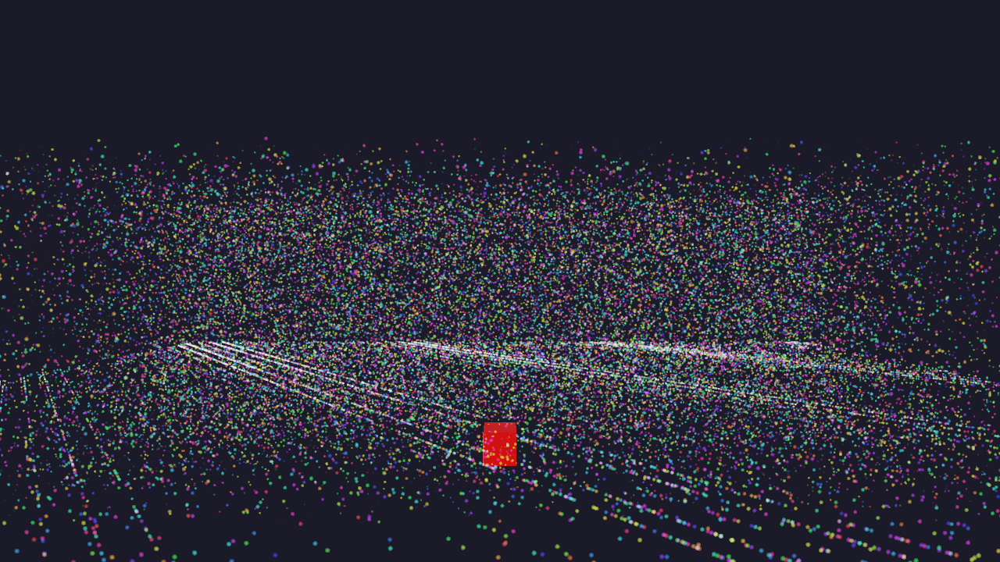</a>

The Python facade demo with its bundled `Box.gltf` fallback and active compute particles; optional Sponza is not installed in the shared asset root.

### ECS bindings (`ecs_bindings_demo`)

This example intentionally creates no meshes or sprites. Its custom components and systems run without visible objects; the deliberately failing system reports its auto-disable in the console. The empty viewport is expected, not a loading failure.

### Canvas UI (`ui_canvas_demo`)

<a href="../images/examples/python/ui_canvas_demo.png">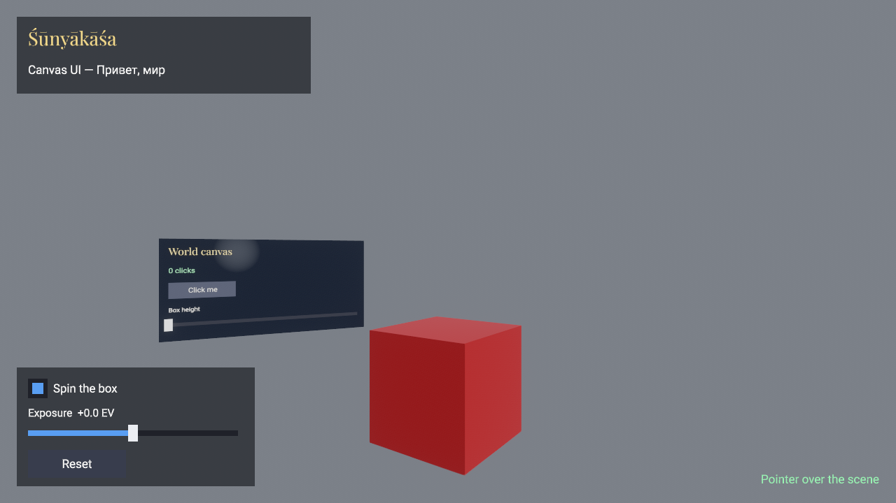</a>

A HUD canvas laid out at 1280 × 720 and a canvas in the world, both on the default pipeline; the world panel is clicked in 3D.

### Animated Fox (`skinned_fox_demo`)

<a href="../images/examples/python/skinned_fox_demo.png">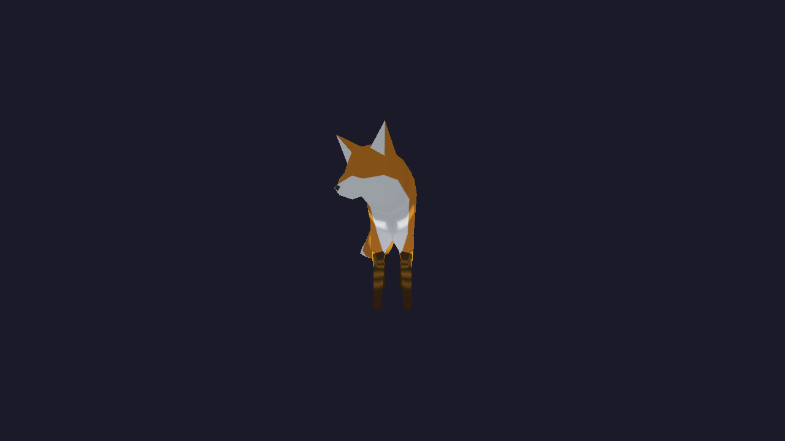</a>

Bundled `Fox.glb` during playback of the first animation clip, driven through the Python bindings.

### Alley (`alley`)

<a href="../images/examples/python/alley.png">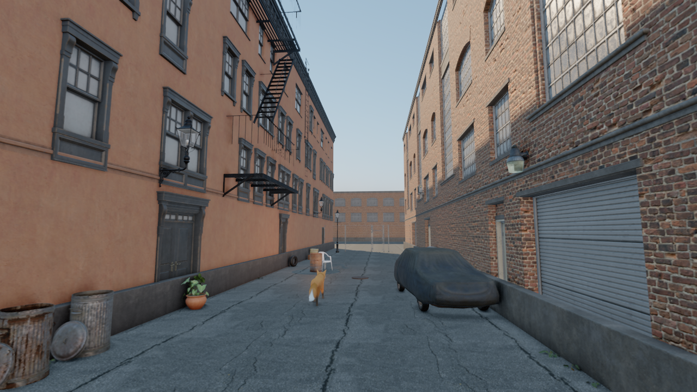</a>

A back alley between an apartment block and an old factory, assembled from [Poly Haven](https://polyhaven.com)'s CC0 modular facades and props, on the [default pipeline](../../python/shoonyakasha/pipelines/default/README.md). **N** turns late afternoon into night over a few seconds: the sun reddens and sets, windows light up one by one, wall lanterns, a security light and a street lamp come on with their own shadows, and exposure follows. **R** switches the sun between ray-traced and cascaded shadows. The models are not in the repository: `python tools/fetch_assets.py alley` downloads them (~120 MB), and the [example's README](../../examples/python/rendering/alley/README.md) explains how the buildings are put together from the modular kits.

### Bistro (`bistro`)

<a href="../images/examples/python/bistro.png">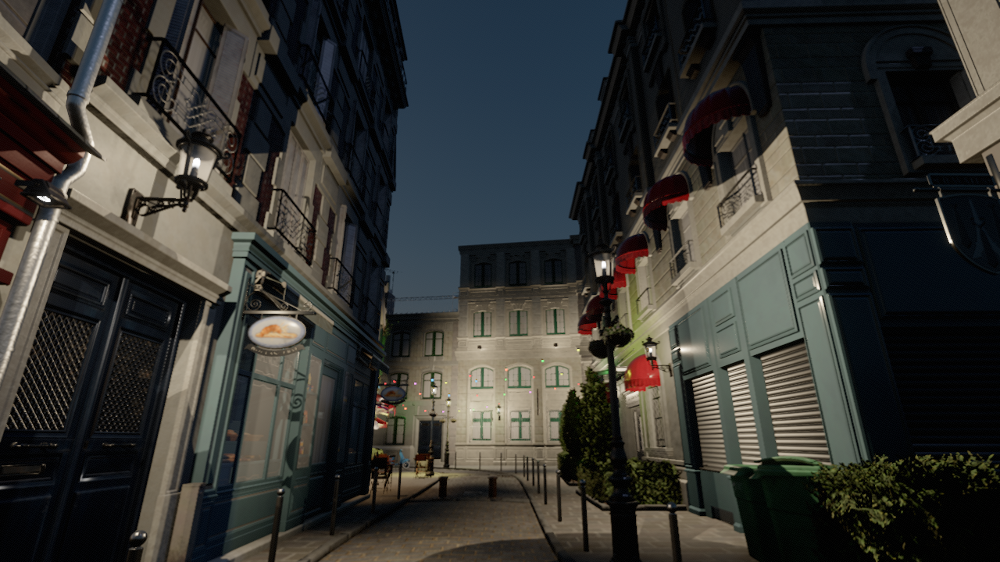</a>

Amazon Lumberyard's Bistro, a Paris street corner of 2.8 million triangles, on the [default pipeline](../../python/shoonyakasha/pipelines/default/README.md). It opens at dusk: the sun leaves the rooftops, then the scene's 96 lights come on one by one, street lamps and lanterns first, then the strings of coloured bulbs over the café terraces. The shadow atlas keeps choosing which lamps near the camera get point shadows as the camera walks from the north lane to the plaza. **N** goes back to day, **R** switches the sun between ray-traced and cascaded shadows. The scene is CC BY 4.0 and not in the repository: `python tools/fetch_assets.py bistro` downloads it (~2 GB) and converts its DDS textures and specular-glossiness materials, as the [example's README](../../examples/python/rendering/bistro/README.md) describes.

### Showroom (`showroom`)

<a href="../images/examples/python/showroom.png">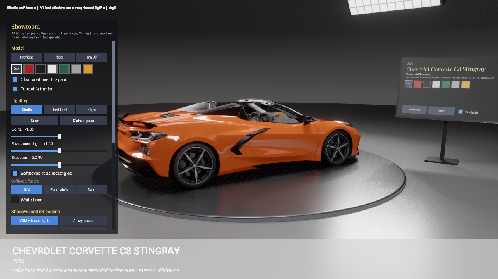</a>

Model: "2020 Chevrolet Corvette C8 Stingray Convertible" (https://skfb.ly/pr7JI) by Ddiaz Design, CC BY 4.0.

A studio for showing models off: each model on a turntable in an infinity cove, on the [showroom pipeline](../../examples/python/rendering/showroom/pipeline/README.md), a copy of the default pipeline.
- **The sun:** its shadows come from a virtual shadow map, eight clipmap levels whose pages are rendered only where visible pixels need them and cached between frames.
- **Softboxes and spotlights:** these are sphere lights with ray-traced soft shadows, and glossy floors and paint get ray-traced reflections.
- **Shadow techniques:** **G** steps through them, ending at the default pipeline's cascades for comparison. **V** shows the map's levels and which of its pages were redrawn this frame.
- **Lighting:** **L** switches between studio softboxes, hard light, night spotlights and neon.
- **Capture:** `--screenshots` saves stills of every model and `--record` films a cinematic tour, with each model's credit on screen.

The cars and starships are Sketchfab models (CC BY and CC BY-NC-SA). `python tools/fetch_assets.py showroom` fetches and converts them with a Sketchfab API token, as the [example's README](../../examples/python/rendering/showroom/README.md) describes; without them it shows the Fox.

### Museum (`museum`)

<a href="../images/examples/python/museum.png">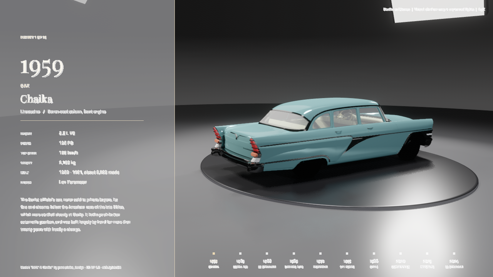</a>

The showroom's cars in the order they were made, on the showroom's pipeline, each beside a placard with its year, maker, figures and a few lines about it. See the [example's README](../../examples/python/rendering/museum/README.md).

Model: "GAZ 13 Chaika" (https://skfb.ly/oIoSW) by panderlaike_design, CC BY 4.0.

### Sponza (`sponza`)

<a href="../images/examples/python/sponza.png">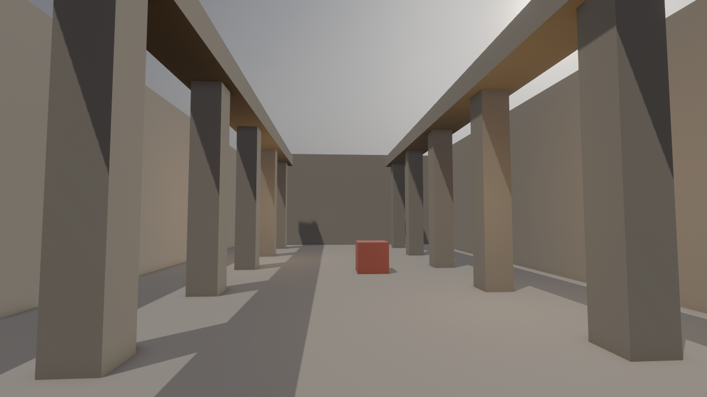</a>

Without the Sponza download: the colonnade of boxes.

Sponza lit by the [default pipeline](../../python/shoonyakasha/pipelines/default/README.md), with no pipeline or shaders of its own: a steep sun through the open roof in four shadow cascades, two warm lamps, ambient occlusion, bloom and automatic exposure. Without the Sponza download it builds a colonnade of boxes, which still shows the shadows and occlusion. **1**, **2** and **3** apply the pipeline's `low`, `medium` and `high` presets with `apply_pipeline_preset`, **4** the `raytraced` one where `ray_query_supported()` says the device can, **V** cycles the debug views and **X** turns automatic exposure off and on.

### Scene lights (`scene_lights`)

<a href="../images/examples/python/scene_lights.png">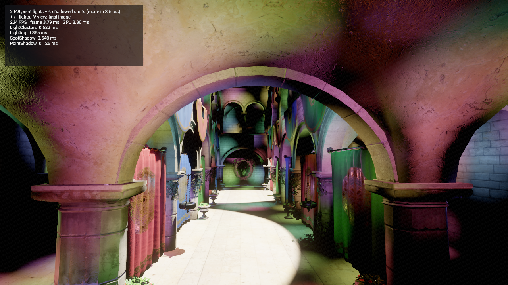</a>

2048 point lights and four shadowed spots in Crytek Sponza, on the default pipeline, from a storage buffer the engine refills every frame. `--benchmark results.md` measures what each light count costs. See the [example's README](../../examples/python/rendering/scene_lights/README.md).

### Volume Tiled Forward Shading (`volume_tiled`)

<a href="../images/examples/python/volume_tiled.png">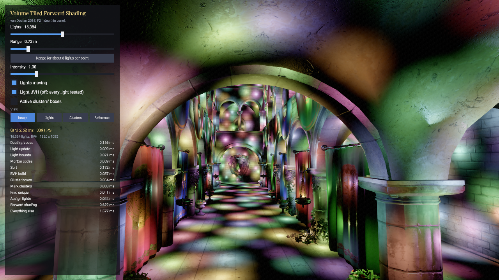</a>

Jeremiah van Oosten's Volume Tiled Forward Shading on the [volume tiled pipeline](../../examples/python/rendering/volume_tiled/pipeline/README.md), a copy of the default pipeline that shades forward. After a depth prepass, only the clusters visible pixels lie in are listed. The lights get Morton codes, are sorted and built into a 32-ary BVH, and each listed cluster walks the BVH for its lights. Up to a million point lights move through Crytek Sponza. **B** compares the BVH with testing every light, and the panel shows each stage's GPU time. `--benchmark results.md` measures a range of light counts, as the paper did. The scene is Khronos's glTF Sponza, cloned from glTF-Sample-Assets into the repository root; without it the example lights a colonnade of boxes. See the [example's README](../../examples/python/rendering/volume_tiled/README.md).

### Reference path tracer (`reference_pt`)

<a href="../images/examples/python/reference_pt.png">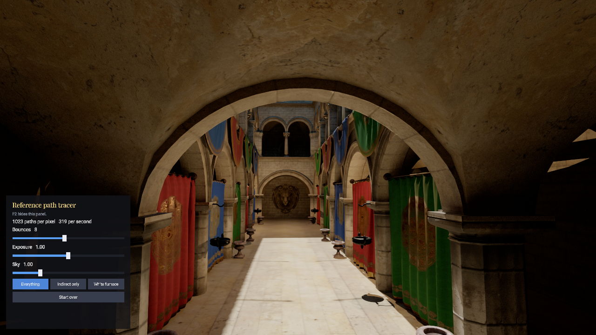</a>

1024 paths per pixel.

A path tracer that traces with ray queries in a compute pass and averages one path per pixel per frame while the camera stands still. At every hit it adds the surface's emission and the scene lights through shadow rays, then continues in a direction drawn from the BRDF. At each hit it reads the triangle and its glTF material through [`sk/scene_hits.glsl`](../../python/shoonyakasha/glsl/sk/scene_hits.glsl), from the rows and textures the engine keeps for the acceleration structure. The BRDF and light model are the default pipeline's, so `--pipeline default` shows the same scene to compare against. Key **3** is a white furnace test. Needs a GPU with ray queries and glTF-Sample-Assets for Sponza; falls back to a colonnade of boxes. In it and the three kajiya examples below, `--scene` also loads the scenes of kajiya's own repository (an observation deck, gas stations, a floating island, a Warhammer diorama, the conference room), which `python tools/fetch_assets.py kajiya` fetches. See the [example's README](../../examples/python/rendering/reference_pt/README.md).

### Irradiance cache (`irradiance_cache`)

<a href="../images/examples/python/irradiance_cache.png">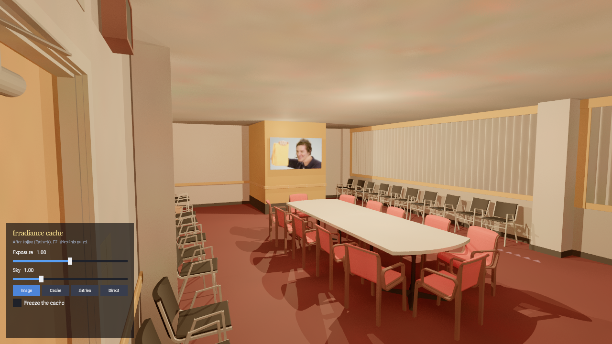</a>

kajiya's conference room (`--scene conference`), 300 frames in. Conference room, (c) Anat Grynberg and Greg Ward.

The irradiance cache of Embark's kajiya, on its own pipeline of compute passes with ray queries:
- **Cells:** twelve cascades of 32³ cells follow the camera. A cell gets an entry from a pool of 65,536 when a surface in it is looked up, and loses it a few frames after the last lookup.
- **Samples:** each frame, every entry traces four new rays and four validation rays into a 4 × 4 octahedral map of the sphere. It keeps one sample per stratum through reservoir resampling, and sums them into L1 spherical harmonics.
- **Bounces:** rays of the cache look the cache up where they land, so light bounces on. Ranks and votes on each entry's trace origin keep light from leaking through walls.

Camera rays are lit by the scene lights and the cache. The scene, lights and camera are the reference path tracer's, for comparison. **1**-**4** switch between the image, the cache alone, its entries and direct light; `--walk` moves the camera down the nave. See the [example's README](../../examples/python/rendering/irradiance_cache/README.md).

### ReSTIR GI (`restir_gi`)

<a href="../images/examples/python/restir_gi.png">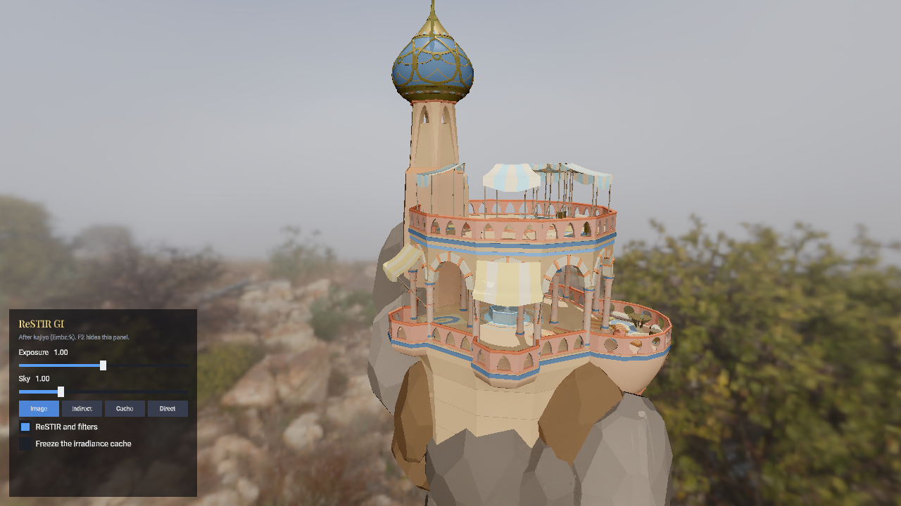</a>

kajiya's observation deck (`--scene viziers`), 300 frames in. "Vizier's observation deck" by winion, CC BY 4.0.

The ray-traced diffuse global illumination of Embark's kajiya, on its own pipeline of compute passes with ray queries:
- **G-buffer:** camera rays find each pixel's surface and its direct light.
- **Candidates:** at half resolution, each pixel traces one diffuse ray a frame. At its hit the ray takes last frame's indirect light when the hit is on screen, and the irradiance cache otherwise.
- **Reuse:** reservoirs reuse the best samples over time (with a permutation of neighbours) and across two spatial passes, the second checked for occlusion through the depth buffer.
- **Validation:** every third frame the reservoirs' samples are traced again, so the history follows changes in the light.
- **Resolve and filters:** a full resolution resolve takes near hits from the raw candidates and far ones from the reservoirs, then temporal and spatial filters.

`--stages` switches each stage on or off, and the reference path tracer's `--mode 3` converges to the same indirect irradiance for comparison. See the [example's README](../../examples/python/rendering/restir_gi/README.md).

### Ray-traced reflections (`rt_reflections`)

<a href="../images/examples/python/rt_reflections.png">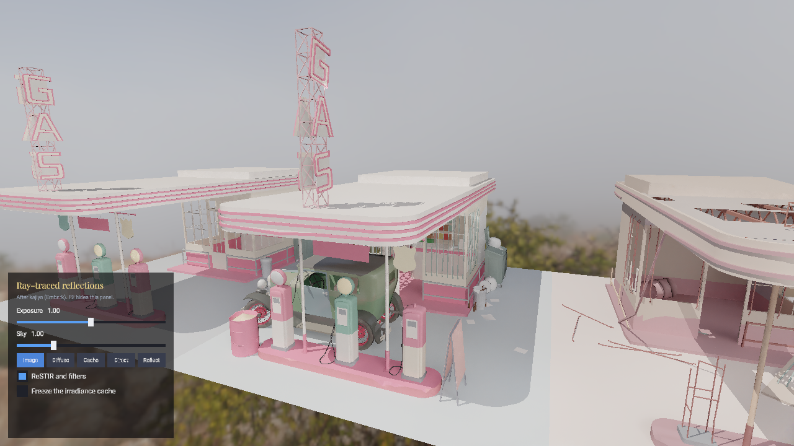</a>

kajiya's gas stations (`--scene gas_stations`), 300 frames in. "gas stations fixed" (https://skfb.ly/6RGDX) by John_Constantine, CC BY 4.0.

Kajiya's ray-traced reflections, on top of the ReSTIR GI example's diffuse light:
- **Candidates:** at half resolution, each pixel draws a ray from its surface's GGX lobe, through the visible normals. At its hit the ray takes the lights, the emission, and the hit's diffuse light: from the ReSTIR GI result on screen, from the irradiance cache elsewhere.
- **Reuse:** reservoirs reuse the rays over time, weighed by luminance and the rays' densities. Every frame a quarter of them is traced again, so they follow changes in the light.
- **Resolve:** a ratio estimator over a world-space kernel shaped like the lobe gives full resolution reflections.
- **Filters:** a temporal filter follows both the surface and the reflected image.

A small table of the lobe's directional albedo, computed for the engine's BRDF, scales the reflections into the image. The reference path tracer's `--mode 4` converges to the same reflections for comparison. See the [example's README](../../examples/python/rendering/rt_reflections/README.md).

### Wave optics (`wave_optics`)

<a href="../images/examples/python/wave_optics.png">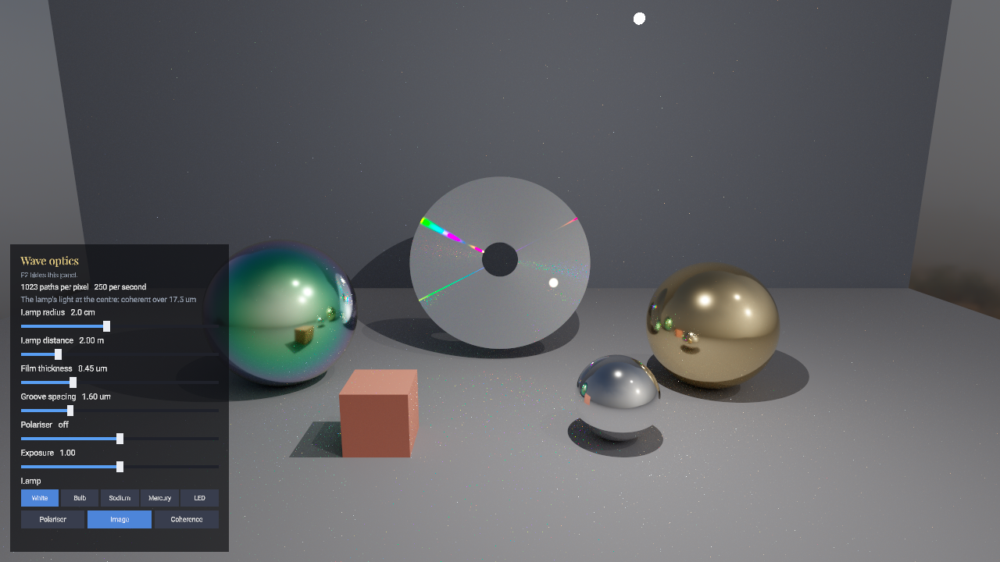</a>

1024 paths per pixel of the default scene.

A spectral, polarised path tracer on its own pipeline, after the physical light transport papers of Steinberg and coauthors:
- **Spectrum and polarisation:** each path carries four wavelengths, and for each the Mueller row that turns the light arriving at a surface into what the camera measures, through an optional polariser.
- **Coherence:** each light's coherence width at a surface follows from how large the light's source appears there. A compact disc's grating spreads its diffraction orders, and glossy lobes widen, as far as the source appears; a thin film's fringes are as visible as the coherence across the film's shear.
- **Materials:** gold and silver with measured refractive indices, the disc's circular grating with scalar efficiencies per order, a film on aluminium.
- **Sample models:** `--scene` loads Khronos's thin-film samples (an abalone shell, three Suzannes, a grid of filmed metal spheres, a lamp, a glass dish of olives) with their glTF materials, `KHR_materials_iridescence` and `KHR_materials_transmission` included, read through the ray instances. Glass refracts through rough microfacets, and its film colours the light it lets through.
- **Lamp spectra:** white, a 2700 K bulb, low-pressure sodium, mercury or an RGB LED, with wavelengths drawn towards the lamp's lines. The disc splits the lines into separate spots, and under sodium light films a few micrometres thick show rings.

The panel sets the lamp's radius, distance and spectrum, the film's thickness, the grooves' spacing and the polariser, and **2** shows the coherence width. Needs a GPU with ray queries. See the [example's README](../../examples/python/rendering/wave_optics/README.md).

### Why gold is gold (`gold`)

<a href="../images/examples/python/gold.png">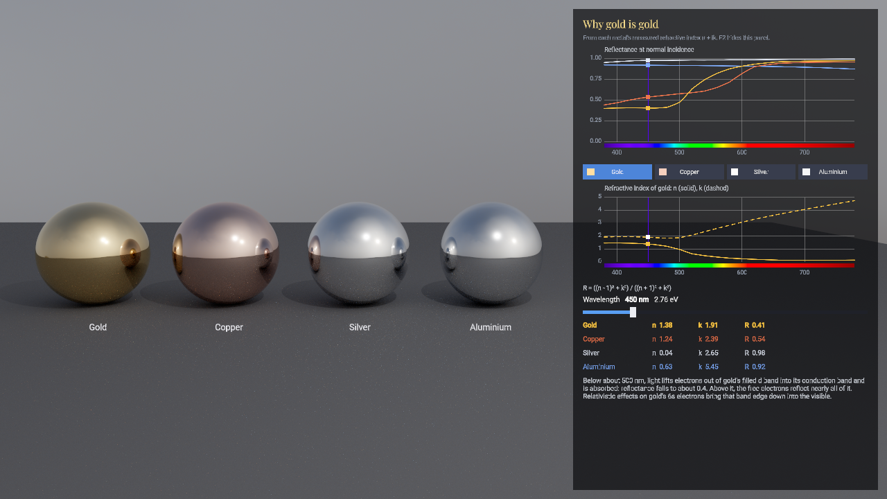</a>

1024 paths per pixel at the default settings.

Polished spheres of gold, copper, silver and aluminium on the wave optics pipeline, each reflecting with its measured complex refractive index at every wavelength. The panel plots, from the same tables:
- **Reflectance** of each metal at normal incidence, over the visible spectrum.
- **n and k** of the selected metal.
- **A wavelength cursor** (slider, or **Left** / **Right**) that reads off n, k and the reflectance of every metal.

**V** renders the light at the cursor's wavelength alone, in grey.

Needs a GPU with ray queries. See the [example's README](../../examples/python/rendering/gold/README.md).

### Japanese shrine (`japanese_shrine`)

<a href="../images/examples/python/japanese_shrine.png">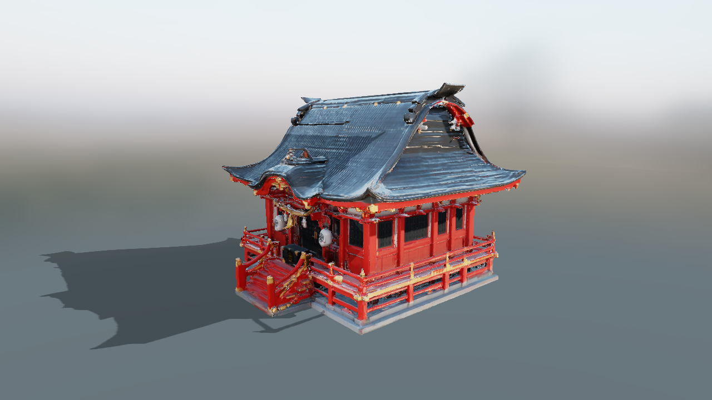</a>

The model's glTF metallic-roughness textures go through the same G-buffer shader as Sponza. `shaders/shrine_lighting.frag` then adds image-based light from `farm_sunset_1k.hdr` and a low sun, draws the environment as the sky, and fades distant ground into it. The sun casts shadows: `ShadowPass` (execution type `shadow_casters`) renders depth into a fixed 2048×2048 `shadowMap` declared in the pipeline JSON, with hardware slope bias from its `depthBias` block, from an orthographic sun projection that `shrine.py` builds and passes in with `set_custom_mat4`. The lighting pass reads it through a comparison sampler, taking a 5×5 kernel of hardware-filtered lookups. The camera circles the shrine; **Space** stops the orbit for free flight, and **O** turns the shadows off and on with `set_pass_enabled`. The model is not in the repository: download it as the [asset guide](../../assets/README.md#not-committed) describes.

`shrine_default.py` shows the same scene on the [default pipeline](../../python/shoonyakasha/pipelines/default/README.md), with no pipeline or shaders of its own: the engine fits four sun cascades, and the pipeline adds contact shadows, ambient occlusion, bloom and automatic exposure (it has no fog). Where the device has ray queries it applies the pipeline's `raytraced` preset, so the sun's shadows are ray traced; **R** switches between those and the cascades. **O**, **G**, **B** and **X** turn shadows, ambient occlusion, bloom and automatic exposure off and on, and **0**–**4** switch between the final image and the cascade, shadow mask, normal and ambient occlusion views.

Model: "Japanese Shrine - Traditional Temple" (https://skfb.ly/pMEO8) by aumiella, licensed under [Creative Commons Attribution 4.0](http://creativecommons.org/licenses/by/4.0/).

### Sprites and UI (`sprite_ui_test`)

<a href="../images/examples/python/sprite_ui_test.png">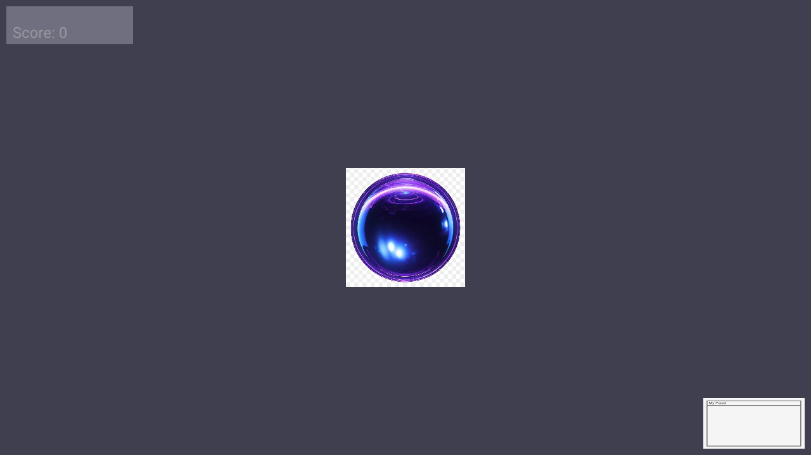</a>

Bundled orb and panel textures with a screen-space score label. The checkerboard around the orb is part of the supplied texture, not an added screenshot background.

### Full showcase (`full_showcase`)

<a href="../images/examples/python/full_showcase.png">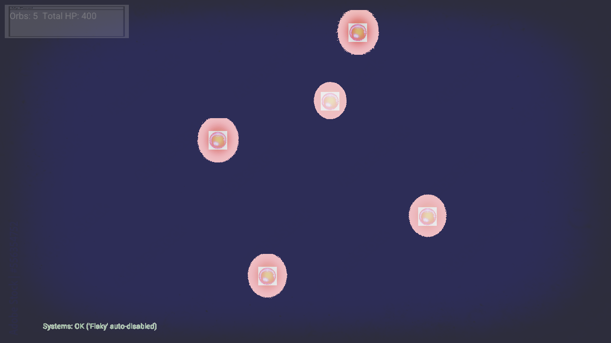</a>

Bundled sprites, layered blend passes, text, and Python ECS systems in motion. The status confirms that the deliberately failing system has auto-disabled.

### Dakini temple (`dakini_temple`)

<a href="../images/examples/python/dakini_temple.png">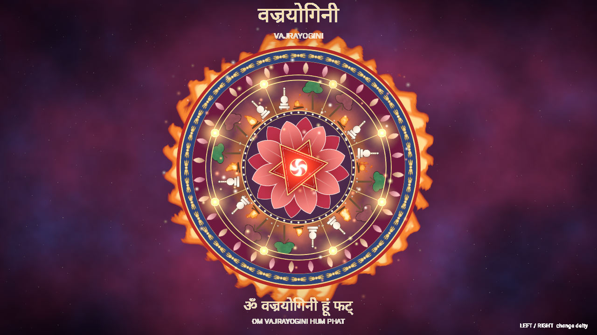</a>

A mandala palace with no textures. `shaders/mandala.frag` draws each layer onto its quad from a `shape` material parameter, and Python systems turn the rings, make the lotus breathe, flicker the lamps and drift the embers. **Left**/**Right** (or **Space**) dim the palace and bring it back for another deity: Vajrayogini, Green Tara, White Tara or Vajrapani. Each has its own palette, centre symbol and mantra, chosen in the shader through the `scene.custom.deity` value. The preview shows Vajrayogini, the first deity.

The names and mantras are in Devanagari, which the engine's ASCII-only text baking cannot shape. `temple.py` renders them with Pillow's raqm (HarfBuzz) layout and the bundled Noto Sans Devanagari into PNGs under `generated/`, and shows them as screen-space panels that fade with the mandala. Without Pillow + raqm it shows the transliterations as engine text instead.

### Canvas UI showcase (`ui_showcase`)

<a href="../images/examples/python/ui_showcase.png">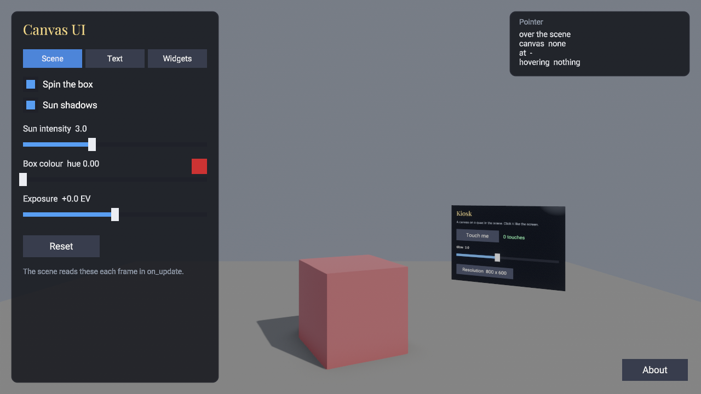</a>

Built entirely through `engine.ui` on the default pipeline:
- **Scene tab** (in the preview): toggles and sliders spin the box, switch the sun's shadows and set its intensity, the box's colour and the exposure.
- **Text tab:** the nine alignments, three fonts with Unicode, and a size slider with wrapping in a clipped box.
- **Widgets tab:** a click counter, a button that a toggle enables, a stepped slider, and a clipped log whose rows are created and destroyed at runtime.
- **Around the sidebar:** a pointer readout at the top right; **About** opens a dialog on a second canvas whose backdrop blocks the HUD. The kiosk in the scene is a world canvas you click in 3D, with a glow slider and a resolution switch.

The rounded frames are a 9-slice of a texture the script writes to `generated/frame.png`. `--tab text`, `--tab widgets` and `--about` open on the other views.

### Pong (`pong_game`) — preview unavailable

Pong uses separately obtained **Simple Ping Pong Assets by Esoe B.Studios**. The local artwork README provides attribution but no license grant, and the [publisher page](https://myebstudios.itch.io/simple-ping-pong-assets) does not establish permission to publish gameplay captures. The bundled font licenses do not cover that artwork. A screenshot is omitted pending permission; see the [capture record](../images/examples/README.md#pong-artwork-permission).
